Versione 0.9.8 (novembre 2026). Per chi installa e amministra il server
dell'organizzazione; chi usa l'app trova tutto nel *Manuale* di
ActivityTrack.

## 1. Cos'è ActivityTrack Web

ActivityTrack Web è il server dell'organizzazione per l'app ActivityTrack:
- tiene una **copia di ogni telefono**, sincronizzata nei due sensi:
  attività, voci *Da fare*, anagrafiche, allegati;
- dà a ciascuno lo **stesso lavoro dal browser**: Home, attività, Agenda,
  Da fare, report;
- gestisce **utenti e profili**, le **anagrafiche centrali** e le
  **policy** che regolano le app dei telefoni.

Un server serve una sola organizzazione. Il telefono funziona anche senza
rete: le modifiche aspettano e partono quando la rete torna.

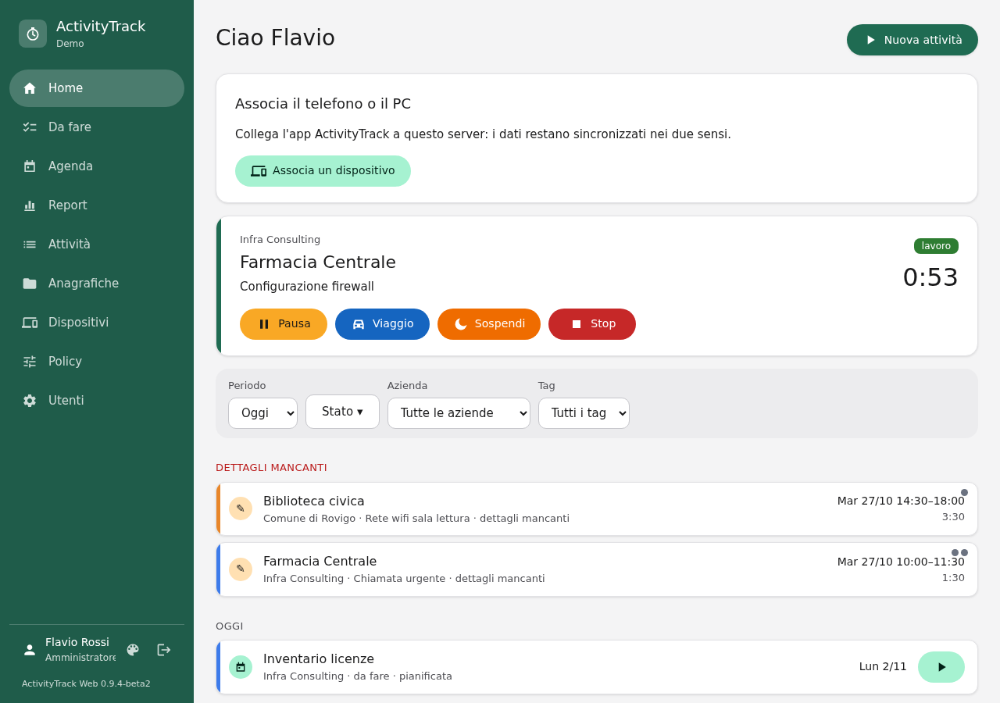

## 2. Installazione e aggiornamenti

Le istruzioni complete sono in `docs/INSTALL.md`, nel repository e nel
pacchetto. In breve:
- **Debian 13 e 14, Ubuntu 24.04 e 26.04**: il pacchetto `.deb` della pagina
  delle release.
- **RHEL / Oracle Linux 9, Arch, FreeBSD 14**: l'archivio `.tar.gz`, o un
  clone del repository.

Il pacchetto prepara l'utente di servizio, le cartelle e il database, ma non
avvia il servizio. Prima si scrive `/etc/activitytrack-web/settings.ini`:

| Chiave | Cosa |
|---|---|
| `[server] base_url` | l'indirizzo HTTPS con cui i telefoni raggiungono il server; finisce nei codici QR. Con un percorso (`https://www.example.com/activitytrack`) l'app vive lì |
| `[server] allowed_hosts` | i nomi e gli indirizzi con cui si raggiunge il server |
| `[server] time_zone` | il fuso dei giorni e dei report (predefinito `Europe/Rome`) |
| `[server] tls_pin` | solo con un certificato autofirmato: l'impronta della sua chiave, che l'app fissa |
| `[database]` | SQLite (predefinito) o PostgreSQL |
| `[files] max_mb`, `offload` | dimensione massima degli allegati; chi li invia: Django, nginx o Apache |
| `[policy] key`, `cert` | chiave e certificato per firmare le policy (facoltativi) |
| `[mail]` | server di posta per i codici di accesso via email (facoltativo) |

Poi si crea l'organizzazione con il primo amministratore e si avvia il
servizio:

```sh
activitytrack-web-manage setup --org "La mia azienda" --admin admin
systemctl enable --now activitytrack-web.socket
```

Davanti serve un web server (nginx o Apache): gli esempi sono in
`/usr/share/activitytrack-web/deploy/`.

**Aggiornare.** Con il pacchetto basta installare il nuovo `.deb`: il
database si aggiorna e il servizio riparte da solo. Con l'archivio o il
clone si sostituisce il codice, poi `activitytrack-web-manage migrate`,
`activitytrack-web-manage collectstatic --noinput` e il riavvio del
servizio.

**Comandi di gestione.** `activitytrack-web-manage` esegue i comandi di
Django con l'utente del servizio, per esempio `migrate`,
`createsuperuser` o `shell`. `setup` e le pagine web chiedono una password
di almeno 10 caratteri, non comune e diversa dal nome utente.
`clean_json_fields` ripara, una volta dopo l'aggiornamento da 0.9.4-beta4 o
precedenti, i tag, i numeri di telefono e i campi dei gestionali salvati da
un telefono in una forma sbagliata (`--dry-run` li elenca soltanto).

## 3. Accesso

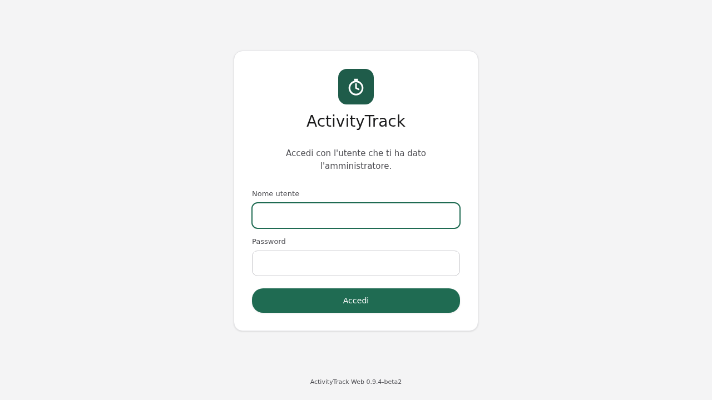

Ognuno accede con il nome utente e la password che gli ha dato
l'amministratore. Dopo 10 tentativi sbagliati di fila dallo stesso
indirizzo, il login si blocca per qualche minuto.

**Verifica in due passaggi.** Da **"Sicurezza dell'account"** (il proprio
nome in fondo al menu) ognuno può chiedere, dopo la password, un codice di
6 cifre:
- da un'**app di autenticazione** sul telefono (Aegis, FreeOTP, Google
  Authenticator…): si inquadra il codice QR e si conferma con il primo
  codice;
- oppure via **email**, se l'utente ha un indirizzo e sul server è
  configurata la posta (`[mail]` in `settings.ini`).

Attivandola si ricevono **10 codici di recupero**, da conservare: ognuno
vale una volta al posto del codice, se si perde il telefono o la posta.
Dopo 5 codici sbagliati si ricomincia dalla password. I telefoni associati
non cambiano: sincronizzano con il loro token.

Il menu a sinistra (sul telefono, la barra in basso) contiene **Home**,
**Da fare**, **Agenda**, **Report**, **Attività**, **Anagrafiche** e
**Dispositivi**; per gli amministratori anche **Policy** e **Utenti**. In
fondo c'è il proprio nome: un clic apre **"Cambia password"**.

## 4. Utenti e profili

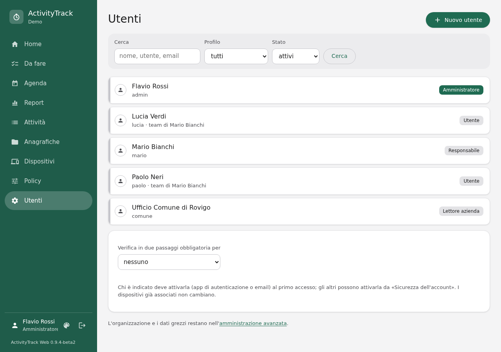

La pagina **Utenti** elenca le persone dell'organizzazione. Si cerca per
nome, utente o email, e si filtra per profilo e stato. **"Nuovo utente"**
chiede nome utente, nome, profilo e una password (almeno 10 caratteri, non
comune, non simile al nome).

| Profilo | Può |
|---|---|
| **Amministratore** | tutto: utenti, telefoni, policy, anagrafiche centrali, i dati di tutti |
| **Responsabile** | le anagrafiche centrali; legge le attività del suo team e quelle fatte per le **sue aziende**, chiunque le abbia fatte; corregge gli orari del suo team; assegna le *Da fare* al team; i report del team |
| **Utente** | le sue attività e *Da fare*, dal telefono e dal web; le sue anagrafiche personali, se la policy lo permette |
| **Lettore azienda** | solo il report delle attività **chiuse** delle aziende assegnate; nessun telefono. Pensato per l'amministrazione di un cliente |

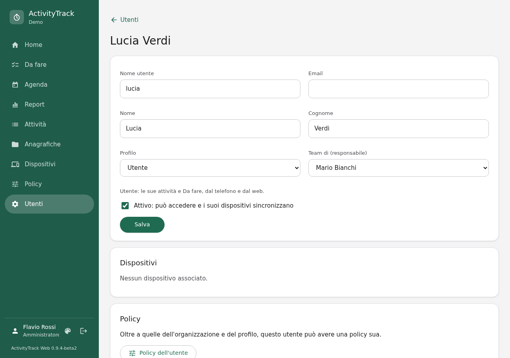

Nella scheda di un utente:
- **Team di (responsabile)**: il responsabile del cui team fa parte.
- **Aziende**, solo per responsabili e lettori: per un responsabile, le
  aziende di cui legge tutte le attività; per un lettore, quelle di cui
  vede il report.
- **Attivo**: togliendo la spunta l'utente non entra più nel web e i suoi
  dispositivi smettono subito di sincronizzare. I dati restano.
- **Dispositivi**: i telefoni e i PC associati, con l'ultima sincronizzazione e
  **"Revoca"**.
- **Policy dell'utente**: apre la sua policy personale (§7).
- **Nuova password**: l'utente esce dal web; i dispositivi restano associati.

Un amministratore non può togliersi il profilo né disattivarsi. L'altro
amministratore, o il comando `activitytrack-web-manage createsuperuser`,
rimedia se serve.

In fondo alla pagina Utenti, **"Verifica in due passaggi obbligatoria
per"**: nessuno, amministratori, amministratori e responsabili, tutti. Chi è
indicato e non l'ha ancora attivata, al primo accesso può solo attivarla.
Nella scheda di un utente, **"Azzera"** la toglie a chi ha perso il
telefono: la riattiva al prossimo accesso. Il lucchetto 🔒 nell'elenco
indica chi l'ha attiva.

La vecchia amministrazione di Django resta raggiungibile dal fondo della
pagina Utenti (**"amministrazione avanzata"**), per l'organizzazione e i
dati grezzi. La usa solo chi ha il profilo Amministratore, e ci si entra
dall'accesso normale, con la verifica in due passaggi e il blocco dei
tentativi sbagliati; ha il tema e il colore scelti nelle preferenze.

## 5. Dispositivi

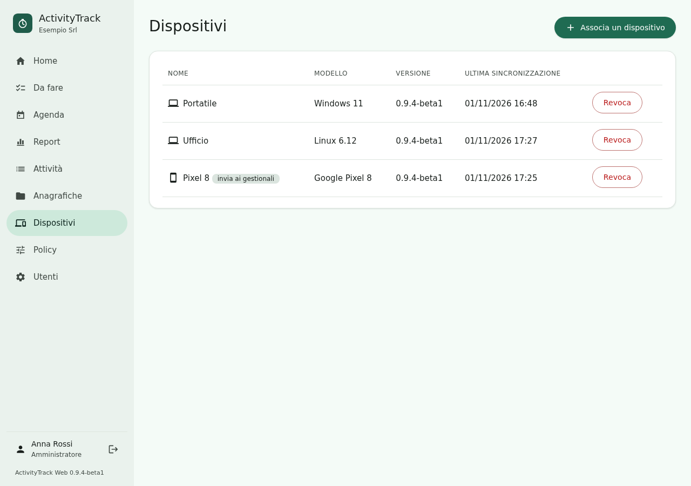

Ogni utente associa i suoi telefoni e PC da **Dispositivi** → **"Associa un
dispositivo"**: compare un **codice QR**, da inquadrare nell'app con
Impostazioni → Sincronizzazione → "Inquadra il codice QR", e sotto il
collegamento da incollare in ActivityTrack Desktop sul PC. Il codice vale
10 minuti e una sola volta; la pagina mostra il dispositivo appena è
associato. Un PC non manda mai ai gestionali.

- **Revoca**: il telefono smette subito di sincronizzare e avvisa
  che il server ha revocato l'associazione. I suoi dati restano sul telefono e sul server.
  Per ricollegarlo serve un nuovo codice.
- **Invia ai gestionali**: con più telefoni, solo quello scelto manda le
  attività ai gestionali (plugin); gli altri lavorano normalmente.

**Quando sincronizza il telefono.**
- pochi secondi dopo ogni modifica;
- con l'app aperta, ogni 30 secondi;
- ogni 15 minuti in background.

Non ci sono notifiche push: una modifica fatta sul web arriva al telefono
entro 15 minuti, o subito se l'app è aperta. Senza rete aspetta e parte al
ritorno della rete.

### Mappe offline per i telefoni

La mappa degli spostamenti dell'app può usare una **mappa offline**: una mappa
basilare (strade, fiumi, laghi, confini, nomi dei luoghi) tenuta sul telefono, che
funziona senza rete. La pagina **Mappe** (solo amministratori) la prepara:

1. Spunta **Rendi disponibili le mappe offline ai telefoni**. Spenta, i telefoni non
   ricevono nulla e tolgono le mappe avute da qui.
2. In **Aree** aggiungi le zone che servono: un **centro** (latitudine e longitudine), un
   **raggio** (5–250 km) e un **livello di zoom**. Il modulo dice, mentre scrivi, quanti
   tile e quanti MB sarà la mappa. In alternativa parti da una delle 23 aree predefinite
   (una città e 100 km attorno) e la modifichi.
3. Il livello 10 (circa 1:400.000, 2–3 MB per 100 km) basta per strade e paesi; l'11
   (circa 1:200.000, 5 MB) aggiunge la ferrovia e più dettaglio. Il massimo si fissa in
   `settings.ini` (`[maps]`); una mappa sopra i 48 MB è rifiutata.
4. Salvando, il server prepara la mappa (qualche decina di secondi) leggendo i dati di
   OpenStreetMap nel formato di Protomaps: serve che raggiunga `build.protomaps.com`.
   La riga mostra *in preparazione*, poi *pronta* (o *non riuscita*, con il motivo; la
   versione precedente resta disponibile). **Aggiorna** la prepara di nuovo.

I telefoni scaricano le mappe con la sincronizzazione, su Wi-Fi (entro 15 minuti, subito
se l'app è aperta) e tolgono quelle che togli tu. Un telefono senza server può avere le
stesse mappe copiando file `.pmtiles` nella cartella `maps` della sua cartella dati.
Dettagli e comandi (`build_maps`, aggiornamento periodico): `docs/OFFLINE-MAPS.md`.

## 6. Anagrafiche

Aziende, clienti, ruoli, tag, scelte rapide e materiali sono **centrali**
(le vedono tutti; le modificano amministratori e responsabili) o
**personali** (di un utente, se la policy lo consente). L'app e il web
mostrano quale è quale. Aziende, clienti e tag hanno un **colore** facoltativo,
scelto tra quelli dell'app, anche dal web.

Se sul telefono e sul server c'è un'anagrafica con lo stesso nome,
diventano una sola alla prima sincronizzazione, con i dati del server. Per i
tag conta il testo: il nome resta, il colore è quello del server.

## 7. Policy

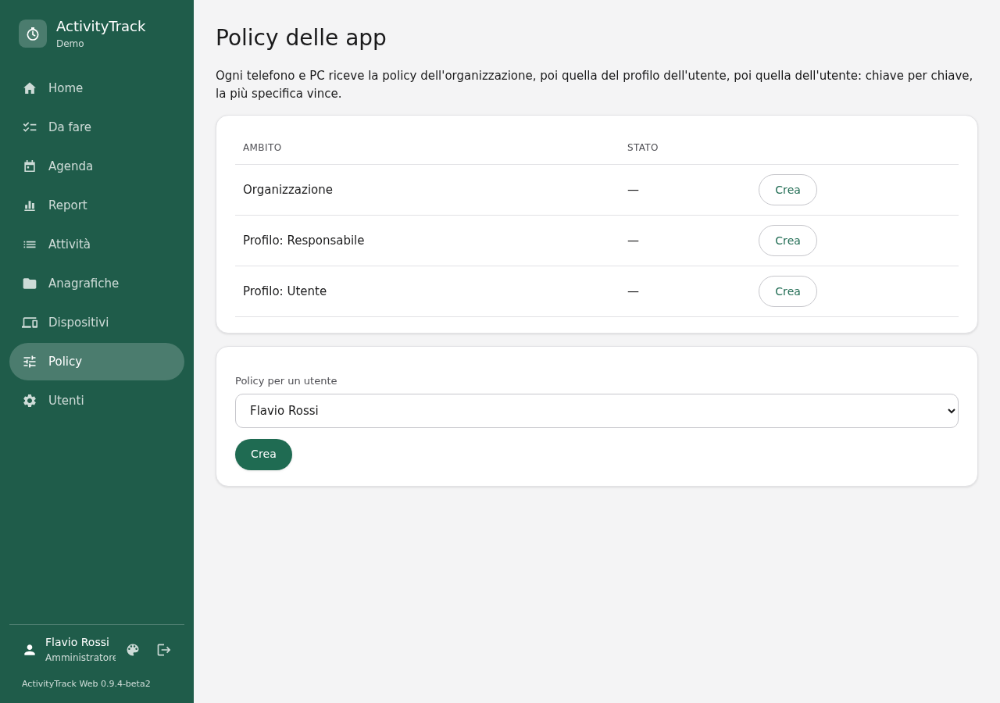

Una policy decide cosa possono fare e cambiare le app dei telefoni:
funzioni, campi, impostazioni, comportamenti. Ogni telefono riceve, chiave
per chiave, la policy dell'**organizzazione**, poi quella del **profilo**,
poi quella dell'**utente**: vince la più specifica. Ciò che resta "non
impostato" lascia l'app com'è.

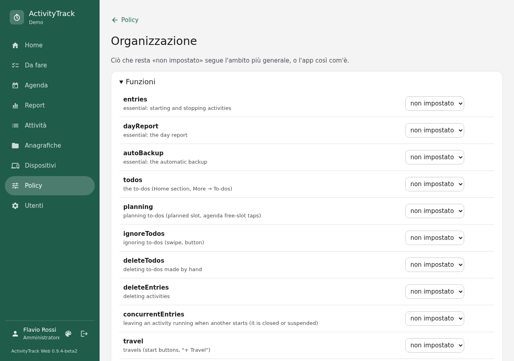

Per ogni impostazione:
- **valore iniziale**: lo propone, l'utente lo può cambiare;
- **bloccato**: l'utente lo vede grigio con il lucchetto;
- **nascosto**: non compare.

Le policy arrivano ai telefoni con la sincronizzazione. Con chiave e
certificato configurati (`[policy]` in `settings.ini`) sono firmate, e
l'app controlla la firma.

Alcune impostazioni valgono anche sul web:
- **Arrotondamenti** e **scavalco notturno** (`rounding…`,
  `carryOverMin`): il web calcola Agenda e Report con le regole della policy
  di ciascuno. Le impostazioni personali del telefono non arrivano al
  server: per avere sul web gli stessi tempi del telefono, conviene fissarle
  nella policy.
- **Orari modificabili** (`editableTimes`) bloccato su "no": sul web
  l'utente può solo aggiungere viaggi e pause; gli orari li corregge un
  amministratore o il suo responsabile.
- **Tag liberi** (`tagsFreeText`) spento: sul web si scelgono solo i tag
  dell'anagrafica.
- La funzione **Da fare** o **Pianificazione** spenta toglie le voci *Da
  fare* dalla Home e la pianificazione dall'Agenda.

## 8. Il lavoro sul web

Ognuno trova sul web il proprio lavoro, come nell'app.
- **Home**: le attività in corso con i comandi (Pausa, Viaggio, Sospendi,
  Stop), poi una lista unica di voci *Da fare* e attività fermate, con i
  filtri periodo, stato, azienda e tag.
- **Attività** e la **scheda dell'attività**: dettagli, orari (segmenti),
  spese, allegati, tag.
- **Agenda**: giorno, settimana e mese; un clic su uno spazio libero
  pianifica una voce *Da fare* a quell'ora.

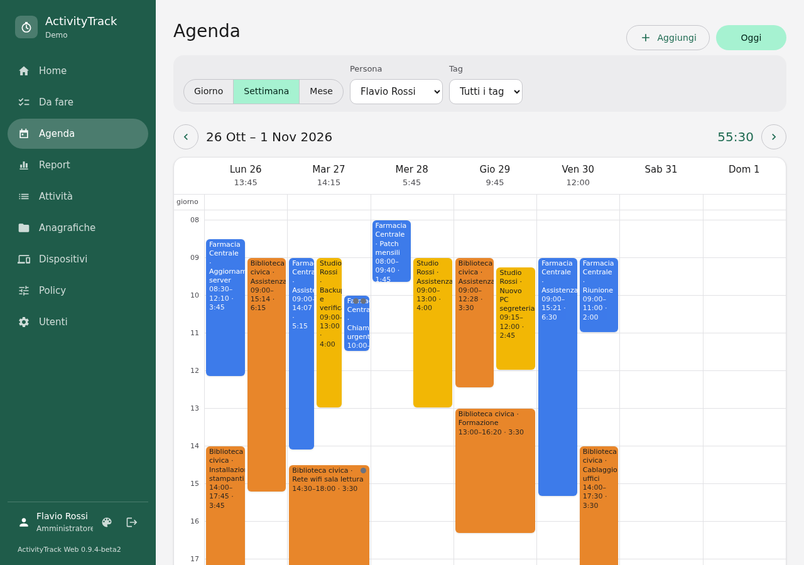

**Date e orari.** Nei moduli date e orari si scrivono nel formato scelto
nelle preferenze, oppure si scelgono con il pulsante a destra del campo: un
calendario che parte dal lunedì e, per gli orari, la **griglia a 5 minuti**
dell'app (una riga per ora, 12 ore alla volta; **▲ Prima** / **Dopo ▼**
spostano la finestra di 3 ore). Inizio e fine si scelgono insieme:
trascinando dalla prima casella all'ultima, oppure toccando la prima e poi
l'ultima, e **OK**; in alto l'intervallo e la durata, le caselle
**tratteggiate** sono occupate da altre attività di quel giorno. **Orario
esatto** accetta i minuti fuori griglia (es. 09:37). Nei moduli l'**azienda**
viene prima del **cliente** e ne filtra l'elenco; scegliendo un cliente,
l'azienda diventa la sua.

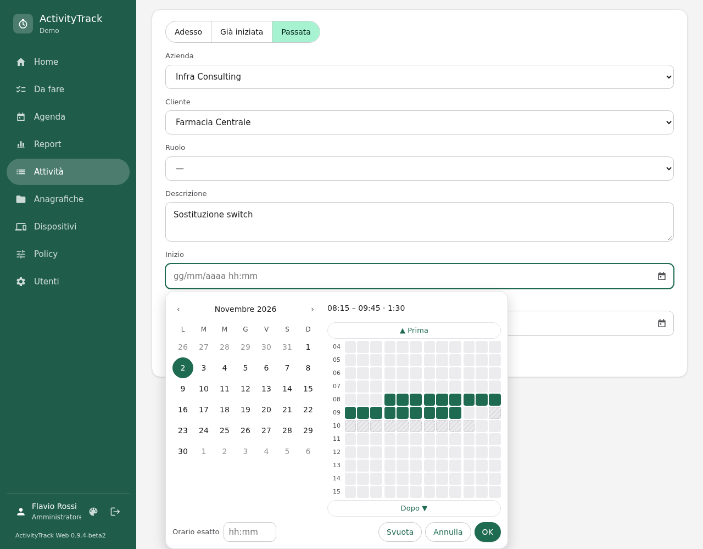

**Preferenze.** Dall'icona della tavolozza, accanto al proprio nome (sul
telefono: *Altro → Preferenze*), ognuno sceglie:
- il **formato delle date**: europeo (31/12/2026), americano (12/31/2026) o
  ISO (2026-12-31);
- il **formato degli orari**: 24 ore (18:30) o 12 ore (6:30 PM);
- il **tema**: chiaro, scuro o come il sistema; le pagine restano bianche e
  grigie (nere nel tema scuro);
- il **colore del tema**, per le barre dei menu e i pulsanti: verde, blu,
  viola, arancione o grigio.

Le preferenze sono dell'utente: valgono su ogni browser con cui accede.

La **lingua** (italiano o inglese) si sceglie nella stessa pagina e vale per il
browser in uso; finché non la scegli, le pagine seguono la lingua del browser.

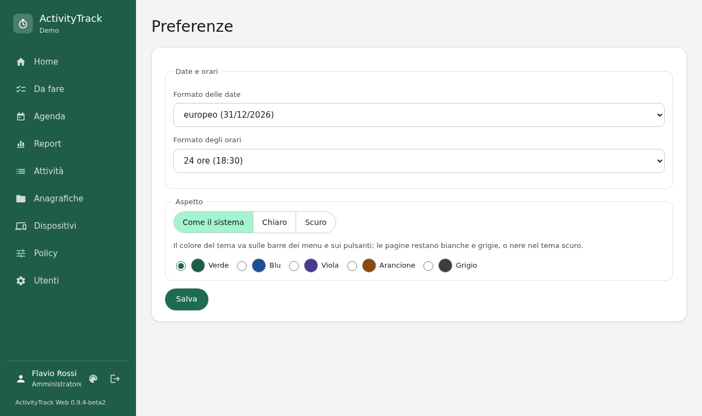

**Da fare assegnate.** Un responsabile, o un amministratore, crea una voce
e sceglie **"Assegnata a"**: la voce diventa della persona scelta e arriva
sui suoi telefoni. Riassegnandola, sparisce dai telefoni di chi l'aveva.
Chi la riceve vede "Assegnata da …" e la lavora come le sue; il
responsabile la segue nella pagina *Da fare* con **Persona → "Tutto il
team"**.

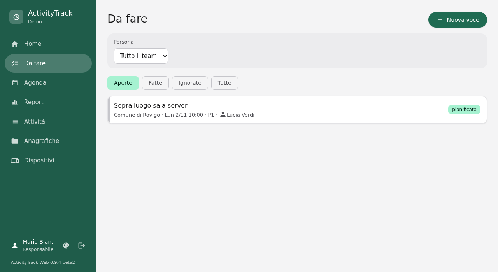

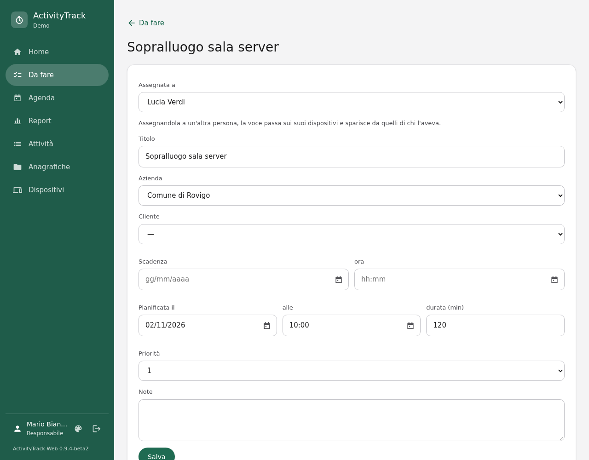

**Verifiche dopo la sincronizzazione.** Se due telefoni hanno modificato la
stessa attività e i tratti si sovrappongono, l'attività diventa **"da
verificare"**. Con gli orari bloccati dalla policy la correggono un
amministratore o il responsabile, dalla scheda sul web. Una modifica che il
server rifiuta (per esempio un'anagrafica centrale bloccata) compare sul
telefono come "Non sincronizzati", con il motivo.

## 9. Report

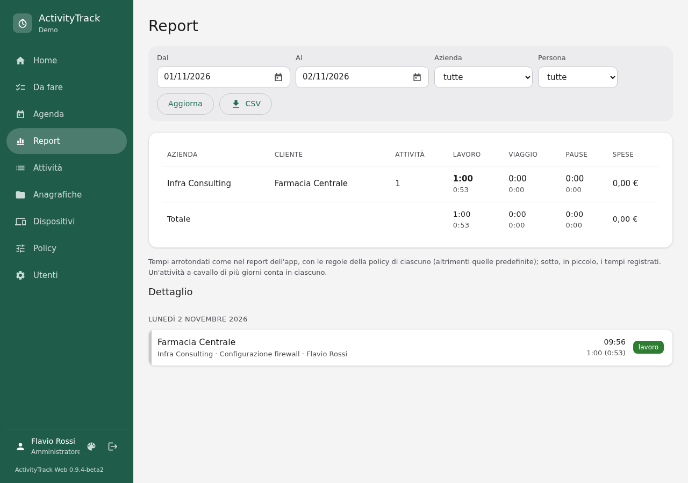

Il **Report** mostra i totali per azienda e cliente in un periodo, con i
tempi **arrotondati** come nell'app e, in piccolo, quelli registrati. Sotto
c'è il dettaglio giorno per giorno. Un'attività a cavallo di più giorni
conta in ciascuno, salvo lo scavalco notturno.

**CSV** esporta una riga per attività e giorno, con i minuti registrati e
quelli arrotondati. Responsabili e amministratori filtrano per persona; un
lettore vede solo le attività chiuse delle sue aziende.

## 10. Sicurezza e backup

Il documento `docs/SECURITY.md` descrive cosa protegge il server e cosa
deve fare l'amministratore. In sintesi:
- solo **HTTPS**, con un certificato valido, o autofirmato e fissato con
  `tls_pin`; poi HSTS nel web server;
- **backup** regolari del database e della cartella `files/` (allegati),
  insieme alla chiave segreta (`/var/lib/activitytrack-web/secret_key`) e
  alla chiave delle policy;
- **aggiornamenti** della distribuzione: Django e le librerie arrivano da
  lì;
- password lunghe, utenti disattivati appena una persona lascia
  l'organizzazione, telefoni persi revocati subito.

Per salvare un database SQLite:

```sh
sqlite3 /var/lib/activitytrack-web/activitytrack.sqlite3 ".backup '/root/activitytrack-$(date +%F).sqlite3'"
```

Con PostgreSQL si usa `pg_dump activitytrack`.

## 11. Problemi frequenti

| Problema | Cosa fare |
|---|---|
| Il sito risponde 400 "Bad Request" | il nome usato non è in `allowed_hosts` |
| Il telefono dice "certificato non valido" | certificato autofirmato senza `tls_pin`, o creato come CA (`docs/INSTALL.md` §4) |
| Il QR non viene letto | aumentare la luminosità dello schermo, o copiare nell'app il collegamento sotto "Non riesci a inquadrarlo?" |
| "Codice scaduto" | il codice vale 10 minuti e una volta: generarne un altro |
| Un utente ha perso il telefono con l'app di autenticazione | usa un codice di recupero, o l'amministratore **"Azzera"** la verifica nella sua scheda |
| Il codice dell'app è sempre "non valido" | l'ora del telefono o del server è sbagliata: va sincronizzata (NTP) |
| Un utente non sincronizza più | è disattivato, o il telefono è stato revocato (Utenti → la sua scheda) |
| Gli allegati non si aprono sul web | con `offload = nginx` o `apache` serve la configurazione del web server dell'esempio |
| Una modifica dal web non arriva subito | arriva entro 15 minuti; aprire l'app la fa arrivare subito |
| Tempi diversi fra telefono e web | arrotondamenti personali del telefono: fissarli nella policy (§7) |
| Dopo un aggiornamento il sito non risponde | `systemctl status activitytrack-web.socket activitytrack-web.service`, e il log con `journalctl -u activitytrack-web` |
