Versione 0.9.2 (ottobre 2026). Per chi installa e amministra il server
dell'organizzazione; chi usa l'app trova tutto nel *Manuale* di
ActivityTrack.

## 1. Cos'è ActivityTrack Web

ActivityTrack Web è il server dell'organizzazione per l'app ActivityTrack:
- tiene una **copia di ogni telefono**, sincronizzata nei due sensi:
  attività, voci *Da fare*, anagrafiche, allegati;
- dà a ciascuno lo **stesso lavoro dal browser**: Home, attività, Agenda,
  Da fare, report;
- gestisce **utenti e profili**, le **anagrafiche centrali** e le
  **policy** che regolano le app dei telefoni.

Un server serve una sola organizzazione. Il telefono funziona anche senza
rete: le modifiche aspettano e partono quando la rete torna.

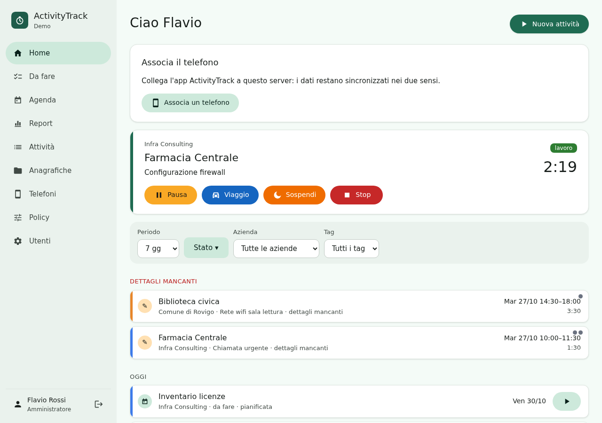

## 2. Installazione e aggiornamenti

Le istruzioni complete sono in `docs/INSTALL.md`, nel repository e nel
pacchetto. In breve:
- **Debian 13 e 14, Ubuntu 24.04 e 26.04**: il pacchetto `.deb` della pagina
  delle release.
- **RHEL / Oracle Linux 9, Arch, FreeBSD 14**: l'archivio `.tar.gz`, o un
  clone del repository.

Il pacchetto prepara l'utente di servizio, le cartelle e il database, ma non
avvia il servizio. Prima si scrive `/etc/activitytrack-web/settings.ini`:

| Chiave | Cosa |
|---|---|
| `[server] base_url` | l'indirizzo HTTPS con cui i telefoni raggiungono il server; finisce nei codici QR. Con un percorso (`https://www.example.com/activitytrack`) l'app vive lì |
| `[server] allowed_hosts` | i nomi e gli indirizzi con cui si raggiunge il server |
| `[server] time_zone` | il fuso dei giorni e dei report (predefinito `Europe/Rome`) |
| `[server] tls_pin` | solo con un certificato autofirmato: l'impronta della sua chiave, che l'app fissa |
| `[database]` | SQLite (predefinito) o PostgreSQL |
| `[files] max_mb`, `offload` | dimensione massima degli allegati; chi li invia: Django, nginx o Apache |
| `[policy] key`, `cert` | chiave e certificato per firmare le policy (facoltativi) |

Poi si crea l'organizzazione con il primo amministratore e si avvia il
servizio:

```sh
activitytrack-web-manage setup --org "La mia azienda" --admin admin
systemctl enable --now activitytrack-web.socket
```

Davanti serve un web server (nginx o Apache): gli esempi sono in
`/usr/share/activitytrack-web/deploy/`.

**Aggiornare.** Con il pacchetto basta installare il nuovo `.deb`: il
database si aggiorna e il servizio riparte da solo. Con l'archivio o il
clone si sostituisce il codice, poi `activitytrack-web-manage migrate`,
`activitytrack-web-manage collectstatic --noinput` e il riavvio del
servizio.

**Comandi di gestione.** `activitytrack-web-manage` esegue i comandi di
Django con l'utente del servizio, per esempio `migrate`,
`createsuperuser` o `shell`.

## 3. Accesso

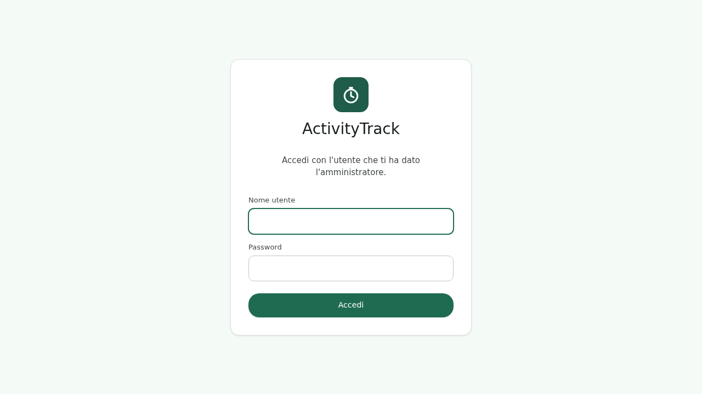

Ognuno accede con il nome utente e la password che gli ha dato
l'amministratore. Dopo 10 tentativi sbagliati di fila dallo stesso
indirizzo, il login si blocca per qualche minuto.

Il menu a sinistra (sul telefono, la barra in basso) contiene **Home**,
**Da fare**, **Agenda**, **Report**, **Attività**, **Anagrafiche** e
**Telefoni**; per gli amministratori anche **Policy** e **Utenti**. In
fondo c'è il proprio nome: un clic apre **"Cambia password"**.

## 4. Utenti e profili

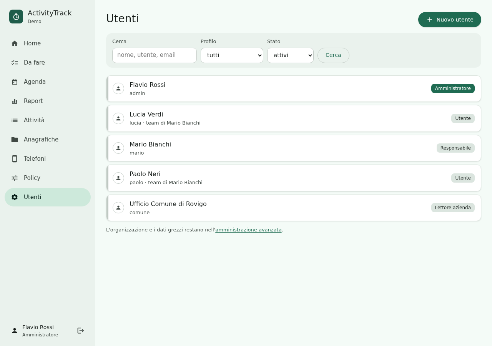

La pagina **Utenti** elenca le persone dell'organizzazione. Si cerca per
nome, utente o email, e si filtra per profilo e stato. **"Nuovo utente"**
chiede nome utente, nome, profilo e una password (almeno 10 caratteri, non
comune, non simile al nome).

| Profilo | Può |
|---|---|
| **Amministratore** | tutto: utenti, telefoni, policy, anagrafiche centrali, i dati di tutti |
| **Responsabile** | le anagrafiche centrali; legge le attività del suo team e quelle fatte per le **sue aziende**, chiunque le abbia fatte; corregge gli orari del suo team; assegna le *Da fare* al team; i report del team |
| **Utente** | le sue attività e *Da fare*, dal telefono e dal web; le sue anagrafiche personali, se la policy lo permette |
| **Lettore azienda** | solo il report delle attività **chiuse** delle aziende assegnate; nessun telefono. Pensato per l'amministrazione di un cliente |

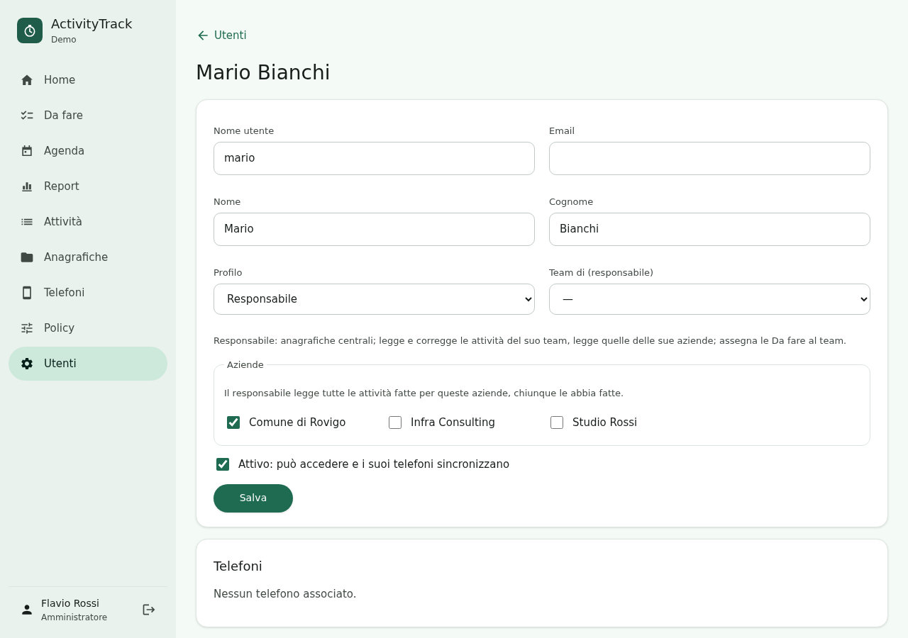

Nella scheda di un utente:
- **Team di (responsabile)**: il responsabile del cui team fa parte.
- **Aziende**, solo per responsabili e lettori: per un responsabile, le
  aziende di cui legge tutte le attività; per un lettore, quelle di cui
  vede il report.
- **Attivo**: togliendo la spunta l'utente non entra più nel web e i suoi
  telefoni smettono subito di sincronizzare. I dati restano.
- **Telefoni**: i telefoni associati, con l'ultima sincronizzazione e
  **"Revoca"**.
- **Policy dell'utente**: apre la sua policy personale (§7).
- **Nuova password**: l'utente esce dal web; i telefoni restano associati.

Un amministratore non può togliersi il profilo né disattivarsi. L'altro
amministratore, o il comando `activitytrack-web-manage createsuperuser`,
rimedia se serve.

La vecchia amministrazione di Django resta raggiungibile dal fondo della
pagina Utenti (**"amministrazione avanzata"**), per l'organizzazione e i
dati grezzi.

## 5. Telefoni

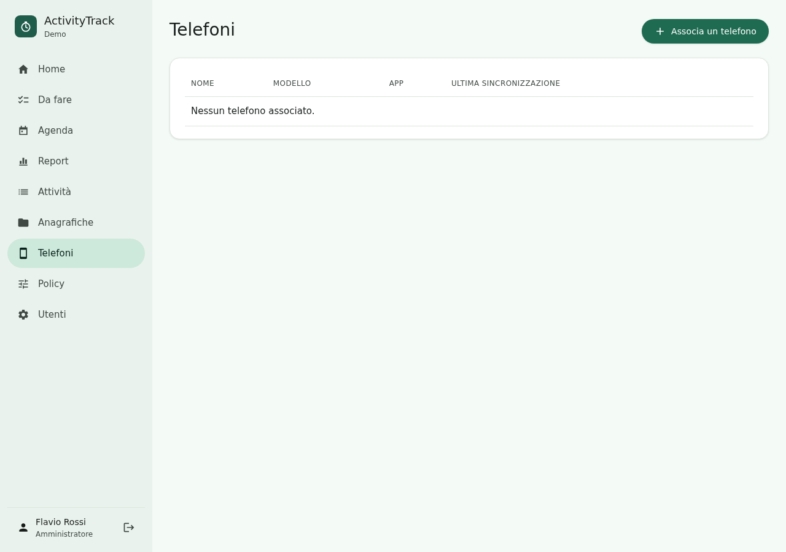

Ogni utente associa i suoi telefoni da **Telefoni** → **"Associa un
telefono"**: compare un **codice QR**, da inquadrare nell'app con
Impostazioni → Sincronizzazione → "Inquadra il codice QR". Il codice vale
10 minuti e una sola volta; la pagina mostra il telefono appena è
associato.

- **Revoca**: il telefono smette subito di sincronizzare e avvisa
  che il server ha revocato l'associazione. I suoi dati restano sul telefono e sul server.
  Per ricollegarlo serve un nuovo codice.
- **Invia ai gestionali**: con più telefoni, solo quello scelto manda le
  attività ai gestionali (plugin); gli altri lavorano normalmente.

**Quando sincronizza il telefono.**
- pochi secondi dopo ogni modifica;
- con l'app aperta, ogni 30 secondi;
- ogni 15 minuti in background.

Non ci sono notifiche push: una modifica fatta sul web arriva al telefono
entro 15 minuti, o subito se l'app è aperta. Senza rete aspetta e parte al
ritorno della rete.

## 6. Anagrafiche

Aziende, clienti, ruoli, tag, scelte rapide e materiali sono **centrali**
(le vedono tutti; le modificano amministratori e responsabili) o
**personali** (di un utente, se la policy lo consente). L'app e il web
mostrano quale è quale.

Se sul telefono e sul server c'è un'anagrafica con lo stesso nome,
diventano una sola alla prima sincronizzazione, con i dati del server. Per i
tag conta il testo: il nome resta, il colore è quello del server.

## 7. Policy

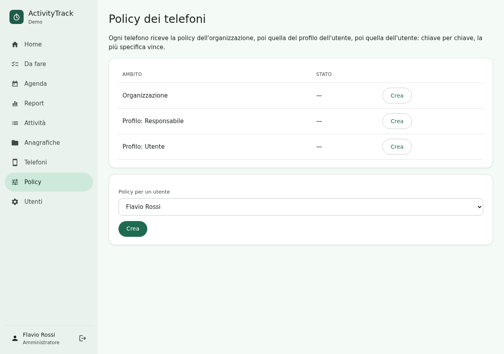

Una policy decide cosa possono fare e cambiare le app dei telefoni:
funzioni, campi, impostazioni, comportamenti. Ogni telefono riceve, chiave
per chiave, la policy dell'**organizzazione**, poi quella del **profilo**,
poi quella dell'**utente**: vince la più specifica. Ciò che resta "non
impostato" lascia l'app com'è.

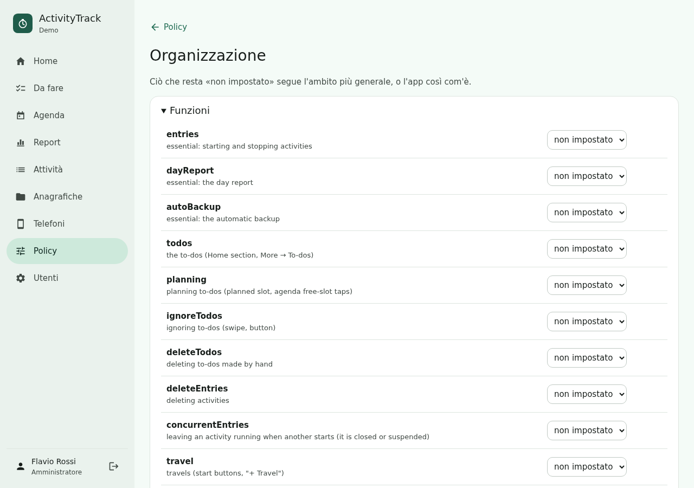

Per ogni impostazione:
- **valore iniziale**: lo propone, l'utente lo può cambiare;
- **bloccato**: l'utente lo vede grigio con il lucchetto;
- **nascosto**: non compare.

Le policy arrivano ai telefoni con la sincronizzazione. Con chiave e
certificato configurati (`[policy]` in `settings.ini`) sono firmate, e
l'app controlla la firma.

Alcune impostazioni valgono anche sul web:
- **Arrotondamenti** e **scavalco notturno** (`rounding…`,
  `carryOverMin`): il web calcola Agenda e Report con le regole della policy
  di ciascuno. Le impostazioni personali del telefono non arrivano al
  server: per avere sul web gli stessi tempi del telefono, conviene fissarle
  nella policy.
- **Orari modificabili** (`editableTimes`) bloccato su "no": sul web
  l'utente può solo aggiungere viaggi e pause; gli orari li corregge un
  amministratore o il suo responsabile.
- **Tag liberi** (`tagsFreeText`) spento: sul web si scelgono solo i tag
  dell'anagrafica.
- La funzione **Da fare** o **Pianificazione** spenta toglie le voci *Da
  fare* dalla Home e la pianificazione dall'Agenda.

## 8. Il lavoro sul web

Ognuno trova sul web il proprio lavoro, come nell'app.
- **Home**: le attività in corso con i comandi (Pausa, Viaggio, Sospendi,
  Stop), poi una lista unica di voci *Da fare* e attività fermate, con i
  filtri periodo, stato, azienda e tag.
- **Attività** e la **scheda dell'attività**: dettagli, orari (segmenti),
  spese, allegati, tag.
- **Agenda**: giorno, settimana e mese; un clic su uno spazio libero
  pianifica una voce *Da fare* a quell'ora.

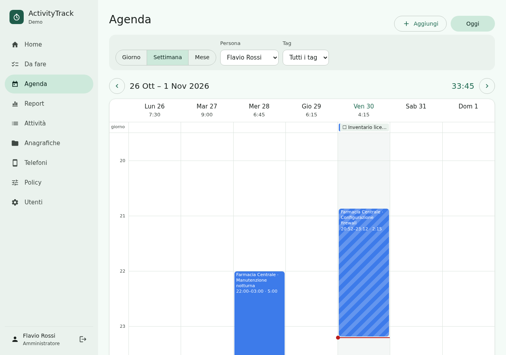

**Da fare assegnate.** Un responsabile, o un amministratore, crea una voce
e sceglie **"Assegnata a"**: la voce diventa della persona scelta e arriva
sui suoi telefoni. Riassegnandola, sparisce dai telefoni di chi l'aveva.
Chi la riceve vede "Assegnata da …" e la lavora come le sue; il
responsabile la segue nella pagina *Da fare* con **Persona → "Tutto il
team"**.

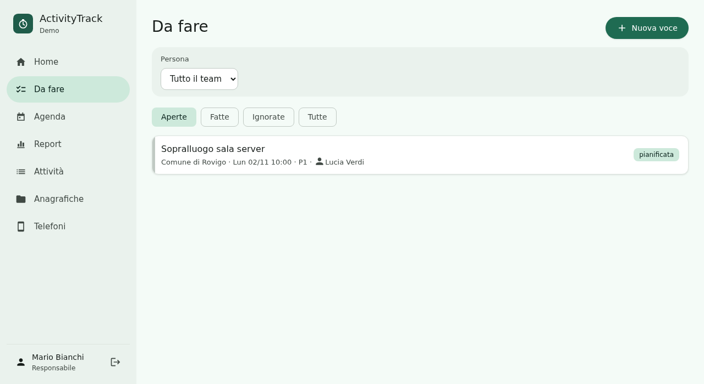

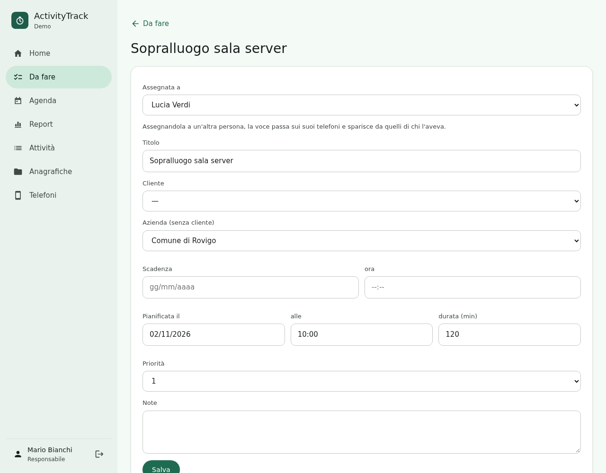

**Verifiche dopo la sincronizzazione.** Se due telefoni hanno modificato la
stessa attività e i tratti si sovrappongono, l'attività diventa **"da
verificare"**. Con gli orari bloccati dalla policy la correggono un
amministratore o il responsabile, dalla scheda sul web. Una modifica che il
server rifiuta (per esempio un'anagrafica centrale bloccata) compare sul
telefono come "Non sincronizzati", con il motivo.

## 9. Report

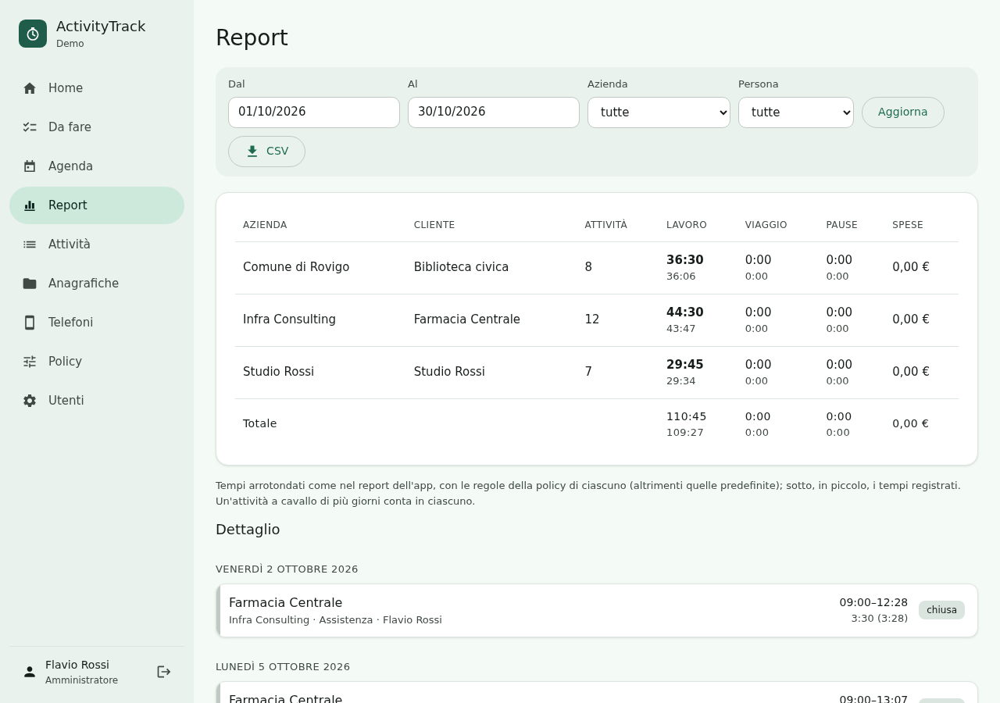

Il **Report** mostra i totali per azienda e cliente in un periodo, con i
tempi **arrotondati** come nell'app e, in piccolo, quelli registrati. Sotto
c'è il dettaglio giorno per giorno. Un'attività a cavallo di più giorni
conta in ciascuno, salvo lo scavalco notturno.

**CSV** esporta una riga per attività e giorno, con i minuti registrati e
quelli arrotondati. Responsabili e amministratori filtrano per persona; un
lettore vede solo le attività chiuse delle sue aziende.

## 10. Sicurezza e backup

Il documento `docs/SECURITY.md` descrive cosa protegge il server e cosa
deve fare l'amministratore. In sintesi:
- solo **HTTPS**, con un certificato valido, o autofirmato e fissato con
  `tls_pin`; poi HSTS nel web server;
- **backup** regolari del database e della cartella `files/` (allegati),
  insieme alla chiave segreta (`/var/lib/activitytrack-web/secret_key`) e
  alla chiave delle policy;
- **aggiornamenti** della distribuzione: Django e le librerie arrivano da
  lì;
- password lunghe, utenti disattivati appena una persona lascia
  l'organizzazione, telefoni persi revocati subito.

Per salvare un database SQLite:

```sh
sqlite3 /var/lib/activitytrack-web/activitytrack.sqlite3 ".backup '/root/activitytrack-$(date +%F).sqlite3'"
```

Con PostgreSQL si usa `pg_dump activitytrack`.

## 11. Problemi frequenti

| Problema | Cosa fare |
|---|---|
| Il sito risponde 400 "Bad Request" | il nome usato non è in `allowed_hosts` |
| Il telefono dice "certificato non valido" | certificato autofirmato senza `tls_pin`, o creato come CA (`docs/INSTALL.md` §4) |
| Il QR non viene letto | aumentare la luminosità dello schermo, o copiare nell'app il collegamento sotto "Non riesci a inquadrarlo?" |
| "Codice scaduto" | il codice vale 10 minuti e una volta: generarne un altro |
| Un utente non sincronizza più | è disattivato, o il telefono è stato revocato (Utenti → la sua scheda) |
| Gli allegati non si aprono sul web | con `offload = nginx` o `apache` serve la configurazione del web server dell'esempio |
| Una modifica dal web non arriva subito | arriva entro 15 minuti; aprire l'app la fa arrivare subito |
| Tempi diversi fra telefono e web | arrotondamenti personali del telefono: fissarli nella policy (§7) |
| Dopo un aggiornamento il sito non risponde | `systemctl status activitytrack-web.socket activitytrack-web.service`, e il log con `journalctl -u activitytrack-web` |
